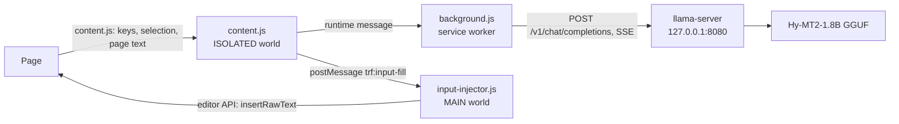

# Hy-MT2 local translator

A browser extension (Chrome / Edge, Manifest V3) that translates in the page using a local llama.cpp server. No cloud API, no account, no key.

Tested on macOS with Edge 155 and `Hy-MT2-1.8B-Q4_K_M.gguf` on CPU. Chrome 111 or newer is required (`world: "MAIN"` content script).

## Features

- **Input box translation**: type three spaces in a text field, or press `Ctrl+Shift+Enter` (`⌘⇧Enter` on macOS). The extension replaces the draft with the translation. Works in plain `<textarea>` and in rich editors (Lexical, Slate, Draft.js).
- **Selection translation**: select text, click the small icon, read the result in a bubble. Copy button included.
- **Full page translation**: floating button in the top-right corner, or `Alt+T`. Dual-language blocks by default, translation-only mode available.
- **Text field safety**: after writing the translation, the extension watches the field for 1.5 s. It only rewrites when the site restores the original text. Sending a message, clearing the field, typing, pressing Enter or Delete all cancel the watch.
- **Translation cache**: SHA-256 keyed by prompt version, language pair, model and source text, stored in `chrome.storage.local`. Default TTL 30 days, 5000 entries, 8 MB budget.
- **Settings page**: service endpoint, model name, shortcut recording, target language, page mode, ignored domains, cache stats.

## Architecture



`content.js` cannot call the editor API directly. Rich editors keep their instance on the page's own JS objects (`element.__lexicalEditor`, React fiber hook state), which are invisible from an extension's isolated world. A second content script runs in the `MAIN` world at `document_start` and performs the write:

```
// content.js -> input-injector.js
{ type: 'trf:input-fill', id, text }
// input-injector.js -> content.js
{ type: 'trf:input-fill-result', id, ok, engine, reason }
```

`engine` is one of `lexical`, `slate`, `draft`, `dom`.

## Requirements

- Chrome / Edge 111+
- llama.cpp `llama-server` binary
- `Hy-MT2-1.8B-Q4_K_M.gguf` (about 1.1 GB). Weights are not in this repo.
- macOS scripts assume `~/Desktop/translate.html`; adjust `TRF_HTML` if it lives elsewhere.

## Install

1. Download the model into `models/` next to `run.sh`:

   ```
   # Any Hy-MT2 GGUF source works; this repo expects Q4_K_M
   curl -L -o models/Hy-MT2-1.8B-Q4_K_M.gguf '<model-url>'
   ```

2. Put `run.sh`, `启动翻译模型.command` and `停止翻译模型.command` in the same directory as `models/` and `bin/llama-b12125/`. Start the service:

   ```
   ./run.sh 1.8b 8080
   # check
   curl http://127.0.0.1:8080/v1/models
   ```

3. Load the extension: open `chrome://extensions`, enable developer mode, click "Load unpacked", select `extension/` (or the unzipped `dist/translate-ext.zip`).

4. Optional: open `web/translate.html` for a standalone translation page. It talks to the same endpoint.

Full script details are in [docs/SETUP.zh-CN.md](docs/SETUP.zh-CN.md).

## Configure

Open the extension options page.

| Item | Default | Notes |
| --- | --- | --- |
| Service URL | `http://127.0.0.1:8080/v1` | Local only; the extension has no other network access |
| Model | `hy-mt2` | Must match `--alias` on the server |
| Input shortcut | `Ctrl+Shift+Enter` | Editable; must include a modifier |
| Target language | Simplified Chinese | Also used by page translation |
| Page mode | Dual language | Or translation-only |
| Cache TTL | 30 days | Stored locally, cleared from options |

Server side defaults: `-np 1`, `-t 4`, `--temp 0.3`, `--top-p 0.6`, `--top-k 20`. Reasons and measurements are in [docs/HANDOVER.zh-CN.md](docs/HANDOVER.zh-CN.md).

## Usage

- Type Chinese or English in any message box. Press three spaces within 800 ms; the draft becomes the translation in place.
- Or press `Ctrl+Shift+Enter` in the field.
- Select text, click the icon next to the selection, copy from the bubble.
- Click the floating button, pick a language, press "翻译". Press `Alt+T` to toggle page translation.

If a site refuses programmatic writes, the extension copies the translation to a card in the bottom-right corner instead of losing it.

## Limitations

- Real Facebook / Messenger with a logged-in session has not been tested. Rich-editor support is validated on an official Lexical 0.42 test page with simulated send and state-sync behaviour.
- Unpacked install only; no store listing, no auto-update.
- CPU inference. A sentence takes about 1 s, a full page of 40+ paragraphs takes tens of seconds.
- Long text is split at 800 characters / 6 paragraphs. Pronouns across chunks can disagree.
- Page translation handles text nodes only. Text inside images, canvas and iframes is skipped.
- Cache stores text only, with no page context.

## Development

```
extension/          runtime source, no build step
web/translate.html  standalone page
web/test-page/      Lexical / controlled-input / selection test fixtures
scripts/            service scripts
tests/              Playwright scripts (v3-v5b)
dist/               packaged zip
docs/               Chinese docs and handover notes
```

Run the automated tests:

```
# 1. translation service
./scripts/run.sh 1.8b 8080
# 2. test pages
python3 -m http.server 8099 --bind 127.0.0.1 --directory web/test-page
# 3. Edge with the unpacked extension and CDP
"/Applications/Microsoft Edge.app/Contents/MacOS/Microsoft Edge" \
  --user-data-dir=/tmp/trf-edge-test --remote-debugging-port=9222 \
  --no-first-run --load-extension="$PWD/extension" \
  http://127.0.0.1:8099/fb_lexical.html
# 4. tests
python3 tests/v5b_test.py
```

`tests/v5b_test.py` covers the input-fill guard (send, site revert, typing, Enter, delete) plus regression cases. Reports and screenshots are written to `test-results/` (ignored by git).

Package and sync:

```
zip -r dist/translate-ext.zip extension
```

## Models and licenses

- Extension code: MIT, see [LICENSE](LICENSE).
- Hy-MT2-1.8B weights: Apache-2.0, published by Tencent Hunyuan. Download separately; not included here.
- llama.cpp: MIT. Install or build separately.

中文文档：[docs/README.zh-CN.md](docs/README.zh-CN.md) · 交接说明：[docs/HANDOVER.zh-CN.md](docs/HANDOVER.zh-CN.md)
