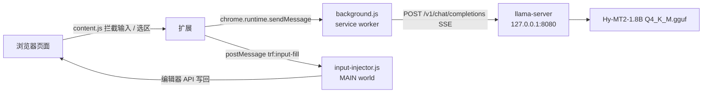

# 交接说明（Hy-MT2 本地翻译扩展）

[English README](../README.md) · [中文说明](README.zh-CN.md) · [安装与使用](SETUP.zh-CN.md)

写给下一个接手的人。读完这一份，不改代码也能启动、测试、打包；要改功能时，先看第 4 节的坑，能省掉大半调试时间。

## 1. 项目是什么

一个 Chrome / Edge 的 MV3 扩展，把本机 llama.cpp 起的翻译服务接进浏览器，提供三件事：输入框连按三次空格翻译、划词翻译、整页翻译。全程本地，不联网、不需要账号。另有一个独立的单页 `翻译.html`，不装扩展也能用。



三条链路的分工：

- `content.js`（ISOLATED world）负责识别触发方式、取原文、判定语言方向、把译文写回，并维护三空格/快捷键/划词/整页的 UI。
- `background.js` 负责真正的模型请求（SSE 流式）、并发队列、翻译缓存、右键菜单和快捷键指令。
- `input-injector.js`（MAIN world）只做一件事：拿到当前焦点的富文本编辑区，用编辑器自己的 API 把文字换掉。

## 2. 目录与文件职责

工作目录：项目根，下文写作 `PROJECT`。路径约定：`MODEL_DIR` 是模型与 llama.cpp 二进制所在目录，与代码仓库分开存放；`PROJECT/translate-ext` 是扩展源码。

```
temp_20261105_03/
├── translate-ext/              扩展运行时（唯一源码，改这里）
│   ├── manifest.json           MV3 清单，content_scripts 两条：ISOLATED + MAIN
│   ├── background.js           service worker：请求、SSE、队列、缓存、菜单
│   ├── content.js              页面逻辑：触发、回填、守护、划词、整页、悬浮球
│   ├── input-injector.js       MAIN world 注入，编辑器 API 回填
│   ├── styles.css              页面内注入的少量样式
│   ├── popup.html/.js/.css     工具栏面板（340px）
│   ├── options.html/.js/.css   设置页（服务、翻译、快捷键、缓存、诊断）
│   └── icons/                  16/48/128 图标
├── translate-ext.zip           当前构建包（与 ~/Downloads 副本一致）
├── README.md                   中文说明与逐阶段实测记录
├── CLEANUP.md                  本次清理清单
├── docs/HANDOVER.zh-CN.md      本文件
├── .work/                      测试脚本与本地测试页（不是发布物）
│   ├── site/                   测试页：test.html、zh.html、fb_lexical.html、lexical_sim.html、messenger_sim.html
│   │   └── vendor/             Lexical 0.42 打包产物（lexical-bundle.mjs）
│   ├── v3_test1.py ~ v5b_test.py   各阶段自动化用例
│   ├── dbg_*.py diag_*.py      单点调试脚本
│   └── make_icons.py           图标生成
└── test-results/               截图与 v*-report.json（测试证据，别删）
```

外部依赖目录：

- `MODEL_DIR`：模型、llama.cpp 二进制、`run.sh`、服务日志。
- `~/Desktop/translate.html`、`启动翻译模型.command`、`停止翻译模型.command`。
- `~/Downloads/translate-ext` 与 `translate-ext.zip`：交付副本。

### content.js 里值得先认识的东西

| 名称 | 位置（行号会变，按名字搜） | 作用 |
| --- | --- | --- |
| `DEFAULTS` | 文件开头 | 所有设置的默认值，改默认值只改这里 |
| `state.settings` | 同上 | 运行时设置，`chrome.storage.onChanged` 会即时刷新 |
| `ui.ensure()` / `ui.toast()` | 中部 | Shadow DOM 根节点（`#trf-root`）与 toast |
| `updateBall` / `ensureCard` / `updateCard` | 悬浮球部分 | 右上角球、语言卡片、进度 |
| `detectLang` / `resolveDirection` | 方向判定 | 粗粒度语言识别 + 源/目标归一 |
| `requestBatch` / `translateLong` | 请求 | 单段/长文本（长文本按 800 字符、6 段切） |
| `findField` / `liveEditable` / `currentFieldText` | 输入框 | 解析存活编辑区、回读文本 |
| `writeField` | 回填主入口 | 依次尝试 level0 → execCommand → paste → Range |
| `mainWorldFill` | 回填 | postMessage 给 MAIN world，1200ms 超时 |
| `startFillGuard` / `judgeGuard` / `cancelFillGuard` | 守护 | 80/300/800/1500ms 回读、判定、作废 |
| `onTripleSpace` | 触发 | 三空格识别、取原文、请求、回填 |
| `comboMatches` / `fieldFromEvent` | 快捷键 | 组合键匹配（默认 Ctrl+Shift+Enter，Mac 显示 ⌘ ⇧ Enter） |
| `showSelectionIcon` / `openBubble` / `positionBubble` | 划词 | 图标、气泡、滚动重定位 |
| `collectParagraphs` / `renderParagraphs` / `runJob` / `drainQueue` | 整页 | 段落收集、批量翻译、串行队列 |
| `startPageTranslation` / `restorePage` / `togglePage` | 整页 | 开始、还原、切换 |

### input-injector.js 的协议

隔离世界看不到页面主世界的 JS 对象，所以写入必须由 MAIN world 脚本执行。两边只靠 `window.postMessage` 说话：

```js
// content.js -> input-injector.js
{ type: 'trf:input-fill', id: '<递增数字>', text: '<译文>' }

// input-injector.js -> content.js
{ type: 'trf:input-fill-result', id: '<同一个 id>', ok: true|false, engine: 'lexical'|'slate'|'draft'|'dom'|'', reason: '<失败原因>' }
```

接收端校验 `event.source === window` 与 `event.origin === location.origin`。写入顺序按元素类型分派：

1. `element.__lexicalEditor` 存在且 `getRootElement() === element` → `root.select(0, root.getChildrenSize())` + `selection.insertRawText(text)`，包在 `editor.update(fn, { tag: 'history-push', discrete: true })` 里（一次撤销、立即 flush）。
2. `data-slate-editor="true"` 或能从 React fiber 的 hook state 找到 Slate editor（判断依据是同时有 `apply` / `insertText` / `children`）→ 构造全文区间后 `editor.insertText(text)`。
3. 能从 fiber 找到 Draft.js 的 `editorState` + `onChange` → `ContentState.createFromText` + `EditorState.push` + `moveSelectionToEnd`，再回调 `onChange`。
4. 都不是 → `focus()` + `execCommand('selectAll')` + `execCommand('insertText')`。

`manifest.json` 里这条 content_script 是 `world: "MAIN"`、`run_at: "document_start"`、`all_frames: false`。前者保证在主世界跑，后者保证页面一加载就挂上监听（等 `document_idle` 会漏掉早期焦点）。

## 3. 一次输入框翻译的完整数据流

以「在 Messenger 输入框里连按三次空格」为例：

1. 捕获阶段的 `keydown` 看到第三个空格（前两个空格在 800ms 内），判定触发。
2. `preventDefault` + `stopImmediatePropagation`，避免站点把三个空格插进输入框。
3. `findField(e.target)` 解析编辑区；`readField` 读取当前文本，`normText` 归一化空白；原文为空直接 toast「请先输入内容」，超过 2000 字提示分段。
4. `detectLang` 粗判语言，`resolveDirection` 结合设置里的目标语言/源语言得出 `{from, to}`。源与目标相同就改写而不是翻译。
5. `ui.toast('翻译中…')`，`requestBatch` 通过 `chrome.runtime.sendMessage({ type: 'translate', ... })` 发给 background。
6. background 先查缓存（键是 `SHA-256(PROMPT_VERSION|src→to|model|原文)`），命中就直接返回；未命中走并发队列（`-np 1` 单槽，默认并发 1），`fetch` 到 `/v1/chat/completions`，按 SSE 逐块 `push` 回内容脚本；`cleanOutput` 去掉「译文：」前缀和整段包裹的引号。
7. content 收到结果后调 `writeField(field, 译文, 原文)`：
   - `mainWorldFill` 走 `level0`（编辑器 API），80ms 后回读，文本一致就成功；
   - 不一致或超时，退 `execCommand('insertText')`；
   - 再退模拟 `paste`（`DataTransfer` + `ClipboardEvent('paste')`，先全选）；
   - 最后退 Range 直接替换文本节点并派发 `beforeinput`/`input`。
8. 任一级成功 → `startFillGuard` 开会话：80/300/800/1500ms 重新回读，只有「被还原成原文」才重试（最多 3 次，先 `level0` 后 paste）。清空、用户改动、回车、点按钮、失焦、删除键都会立刻作废会话。
9. 全部失败 → 恢复原文，右下角弹译文卡片（可复制）+ toast。

整页翻译走另一条：`collectParagraphs` 按块聚合文本节点，`splitIntoUnits` 切成 ≤800 字符 / ≤6 段，`drainQueue` 串行请求，`renderParagraphs` 插入 `.trf-tr-block`。失败批次重试一次，段数与返回不一致时用 `forceAlign` 按原段落切分，不会把两段合成一段。

## 4. 关键设计决策与踩过的坑

按时间顺序，每条都对应一次真实失败。

1. **只写 DOM 一定失败（Lexical）**。在 `contenteditable` 上 `execCommand('insertText')` 返回 `true`，但 Lexical 的 `beforeinput` 处理器会拦下并用自己的 state 重渲染，900ms 后 DOM 又变回原文。对照实验（v5 L4）留了证据：返回值 true、最终文本仍是中文。结论：必须改编辑器内部状态，不能只改 DOM。

2. **所以必须有 MAIN world 脚本**。`element.__lexicalEditor`、React fiber 上的 hook state 都是页面主世界对象，ISOLATED world 拿到的 DOM 包装看不到。`content.js` 只能负责识别和请求，写入交给 `input-injector.js`。这是照 read-frog 的做法：`root.select + insertRawText`，而不是模拟按键或粘贴。

3. **`markDirty` 式的重渲染会吃掉写入**。官方 Lexical 测试页用 400ms `editor.update($getRoot().markDirty())` 模拟 FB 的内部 state 同步；写入后能连续挺过 7 次同步才算成功。这也是守护窗口存在的理由。

4. **守护窗口曾把「发送后清空」当成「被还原」**。旧实现只判断 `cur === want`，不相等就重试 paste；用户点发送后站点清空输入框，`cur=''` 不等于译文，于是译文被写回，消息发出但草稿不清空。现在的判定是四种状态：`ok`（等于译文）、`reverted`（等于原文或原文的一部分，唯一允许重试）、`empty`（空/纯空白，立即终止）、`changed`（两者都不是，终止）。另外每次回填都有 `fillGuardGen` token，回车、疑似发送按钮 `pointerdown`、失焦、选区离开、真实删除、内容变空都会 `cancelFillGuard`，之后不再有任何写入，也不弹卡片、不残留 toast、不抢焦点。

5. **Lexical 全选删除不一定发 `beforeinput`**。用 CDP 发真实 `Delete` 时，页面只收到 `keydown`（事件记录里 `beforeinput`/`input` 一条都没有），内容照样被清空。只监听 `beforeinput` 会漏，所以同时监听 `isTrusted` 的 `Delete` / `Backspace` 键。S5 的取消原因因此是 `delete-key`。

6. **三空格在富文本站失效，是事件被站点先吃掉了**。普通 `keydown` 监听在冒泡阶段，站点先 `preventDefault` 就轮不到我们。改成 `document` 捕获阶段 + `stopImmediatePropagation`；同时处理 `beforeinput`（`inputType` 为 `insertText` 且 `data` 是空格）和组合输入（`isComposing` 时不计）。否则中文输入法选词过程中的空格会误触发。

7. **翻译期间用户继续打字就别回填**。请求返回时如果输入框文本已经和触发时不同，放弃回填，toast 提示「内容已修改，已取消回填」。硬写会把用户新打的内容冲掉。

8. **缓存键必须包含提示词版本和目标语言**。`SHA-256(PROMPT_VERSION|src→to|model|原文)`，`PROMPT_VERSION` 每次改 `SYSTEM_PROMPT` 都要加一，否则旧译文会命中新提示词。换目标语言必然是不同键，不会出现中英混排。缓存放 `chrome.storage.local`，默认 TTL 30 天、上限 5000 条、超过 8MB 主动淘汰最旧 20%。

9. **服务端单槽 `-np 1` 是测出来的，不是拍的**。3 并发压测：`-np 2` 吞吐只 +12%，`-np 3` 反而 -21%，而且每槽分到的上下文变小。本地单实例排队比并行稳，扩展侧也把并发默认设成 1。

10. **`minimum_chrome_version` 是 111**。`world: "MAIN"` 需要 Chrome 111+，清单里写死避免低版本静默不注入。

11. **`Alt+T` 整页快捷键在 Mac 上会和系统/站点冲突时**，设置页允许改，扩展自己在捕获阶段匹配组合键，匹配成功才 `preventDefault`。

## 5. 本地服务参数

`temp_20261105_02/run.sh` 的实际启动命令：

```
llama-server -m models/Hy-MT2-1.8B-Q4_K_M.gguf \
  --alias hy-mt2 --host 127.0.0.1 --port 8080 \
  -c 4096 -t 4 -ngl 0 -np 1 \
  --temp 0.3 --top-p 0.6 --top-k 20 --repeat-penalty 1.05 --no-webui
```

| 参数 | 含义 | 为什么这么选 |
| --- | --- | --- |
| `--alias hy-mt2` | `/v1/models` 与请求里的模型名 | 扩展默认 `model: hy-mt2`，名字对不上会 404 |
| `-c 4096` | 上下文 4096 | 整页最长批次 800 字符，4096 够用且省内存 |
| `-t 4` | 4 线程 | 机器 4 物理核，超线程再多给线程只会互相抢 |
| `-ngl 0` | 纯 CPU | 这台机器没有可用 GPU 后端；上 GPU 要改这行 |
| `-np 1` | 单槽串行 | 见第 4 节第 9 条，并发收益为负 |
| `--temp 0.3` | 客户端不传采样参数时的默认温度 | 比官方 0.7 稳，同一句重复翻译结果一致，术语不漂 |
| `--top-p 0.6 --top-k 20` | 采样范围 | 翻译要的是确定性，不需要多样性 |
| `--repeat-penalty 1.05` | 轻微抑制重复 | 1.0 时偶尔整段复读 |

实测数字（同一批测试句，CPU）：

- Q4_K_M：14.33 tok/s，句子级请求往返约 0.9–1.5s。
- Q8_0：8.73 tok/s，比 Q4 慢 39%，质量没有明显提升。Q8 档已在清理中删除，`./run.sh 1.8b-q8` 会提示模型不存在。
- 缓存命中：整页第二次翻译状态栏显示「缓存命中 19 段 · 0.01s」量级。

## 6. 构建、测试、打包、同步

### 构建

没有构建步骤，`translate-ext/` 就是运行时源码，改完直接重载扩展。测试页里的 Lexical 是预先打包好的单文件：

```
cd .work && npm i esbuild @lexical/rich-text@0.42.0
# 重新生成 .work/site/vendor/lexical-bundle.mjs 时，入口导出 lexical core + registerRichText
```

`registerRichText(editor)` 不能省。只 `createEditor` + `setRootElement` 的话，敲字完全没反应（测试页第一版就栽在这）。

### 测试

测试用 Edge + Playwright 连 CDP，需要三个东西同时在线：

1. 翻译服务：`MODEL_DIR/run.sh 1.8b 8080`
2. 测试页静态服务：`python3 -m http.server 8099 --bind 127.0.0.1 --directory .work/site`
3. 开了远程调试的 Edge（临时 profile，加载扩展）：

```
"/Applications/Microsoft Edge.app/Contents/MacOS/Microsoft Edge" \
  --user-data-dir=/tmp/trf-edge-test --remote-debugging-port=9222 \
  --no-first-run --no-default-browser-check \
  --load-extension="$PROJECT/translate-ext" \
  http://127.0.0.1:8099/fb_lexical.html
```

然后 `python3 .work/v5b_test.py`（或 v4/v5）。脚本会自己往 `chrome.storage.sync` 写一套测试设置，结果落在 `test-results/*.json`。改 content.js 后必须重启 Edge 实例，扩展不会热更新。脚本只依赖 `playwright`。

### 打包与同步

```
cd "$PROJECT"
rm -f translate-ext.zip
zip -r -q translate-ext.zip translate-ext
rsync -a --delete --exclude 'test-results/' --exclude 'tests/' \
  --exclude 'node_modules/' --exclude '.git/' --exclude '*.log' --exclude '*.md' \
  translate-ext/ "$HOME/Downloads/translate-ext/"
cp translate-ext.zip "$HOME/Downloads/translate-ext.zip"
```

校验：源目录与下载目录逐文件 `shasum -a 256` 对比；`unzip -p translate-ext.zip translate-ext/content.js | shasum -a 256` 与源文件对比。浏览器里已加载过 `~/Downloads/translate-ext` 的，要在扩展页点「刷新」，再刷新页面。

## 7. 改提示词 / 加语言 / 换模型

**改提示词**：`background.js` 顶部的 `SYSTEM_PROMPT`，同时把 `PROMPT_VERSION` 往上加一（例如 `p2` → `p3`）。不加版本号，旧缓存会被新提示词复用，看起来像"改了没生效"。改完重新跑一遍 v5b，确认段数对齐没坏。

**加语言**：

1. `content.js` 的 `TARGETS`（下拉里出现的目标语言）和 `SOURCE_LANGS`（源语言下拉）各加一项。
2. `background.js` 的 `SRC_NAMES`、`TARGET_NAMES` 补上显示名，`buildInstruction` 靠它拼指令。
3. 如果新语言有特殊写法（比如阿拉伯语 RTL），检查 `renderParagraphs` 的块样式是否需要 `direction`。
4. 加完用 `.work/v3_test3.py` 的换语言用例验一次。

**换模型**：

1. 新 GGUF 放进 `temp_20261105_02/models/`。
2. `run.sh` 里加分支或直接改 `1.8b)` 的 `MODEL=`；`--alias` 改成新名字。
3. 扩展设置页的「模型名」改成同名，或 `background.js` 的 `DEFAULTS.model` 改掉。
4. 换模型等于换缓存语义：`PROMPT_VERSION` 或模型名变了缓存键自然会变，不需要手动清。

## 8. 已知限制与待办

限制：

- 真实 Facebook / Messenger **登录态**没测过。测试只在官方 Lexical 0.42 等价页上跑，页面行为（内部 state 同步、发送后清空）是按观察到的特征模拟的。真实 composer 如果不用 Lexical，会落到 Slate/Draft/fallback 分支。
- 浏览器只能加载 unpacked 扩展，没有上架商店，也没有自动更新。
- 长文本按 800 字符切，超长段落会被拆成多段翻译再拼回；跨段的代词指代可能不一致。
- 整页翻译只处理文本节点，图片里的字、canvas、iframe 内容不处理。
- 缓存只存文本，不存上下文；同一句在不同页面命中同一译文。
- CPU 推理，整页几十段要几十秒；中止按钮只能停后续请求，当前请求会跑完。

待办（按优先级）：

1. 在真实 FB 登录态下复测三空格、快捷键、发送后清空这三条。
2. `postMessage` 协议加一个版本字段，避免以后改字段名时新旧脚本互不认识。
3. 整页翻译支持按视口懒加载，减少一次性请求量。
4. 划词气泡的复制按钮在部分站点会被 `user-select: none` 影响，需要复测。
5. 设置页的「忽略域名」目前只按 hostname 精确匹配，不支持通配。

## 9. 版本与验证基线

- 扩展 `manifest.json`：`version 1.0.0`，`minimum_chrome_version 111`。
- 当前源码对应 `translate-ext.zip`（72,022 字节）；`content.js` SHA-256 为 `d9595992c06993b207397da6a9404bed2384f92e5cbe0dafbd67ffd2977696f8`。
- 已跑过的自动化基线（都在 `test-results/` 有报告与截图）：

| 报告 | 用例数 | 覆盖 |
| --- | --- | --- |
| `v3-report-1.json` | 20 | 悬浮球、语言卡片、popup |
| `v3-report-2.json` | 12 | 缓存与回归 |
| `v3-report-3.json` | 21 | 自动提示收紧、源语言 |
| `v4-report.json` | 22 | 富文本回填、守护窗口、自定义快捷键 |
| `v5-report.json` | 10 | MAIN world 编辑器 API 回填 |
| `v5b-report.json` | 11 | 发送后不清空（S1–S5 + 回归），81.1s 全过 |

- 改动后至少跑 `v5b`；动到整页或缓存再跑 `v3_test2/3`；动到 UI 再跑 `v3_test1`。
